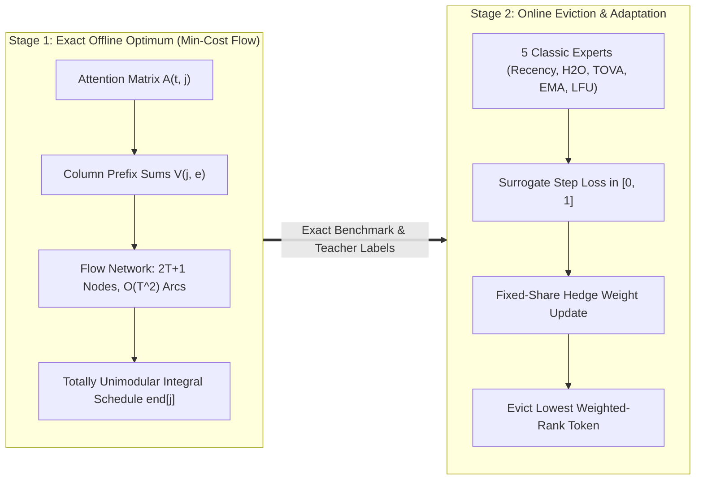
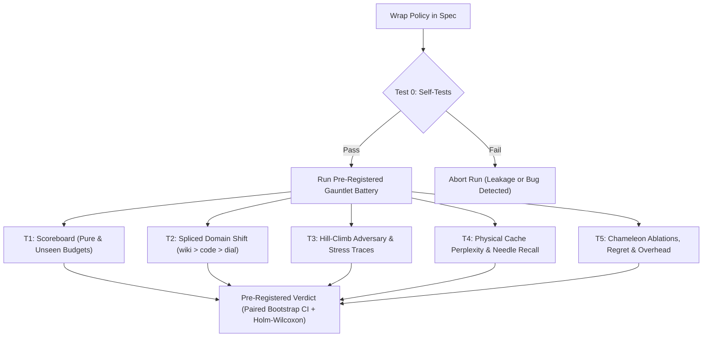
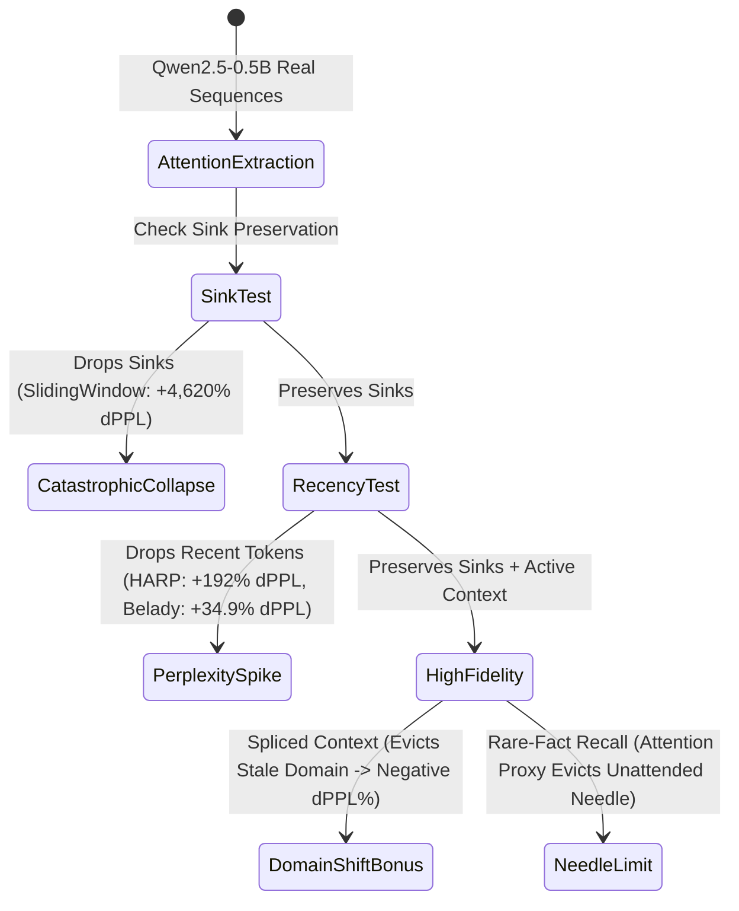
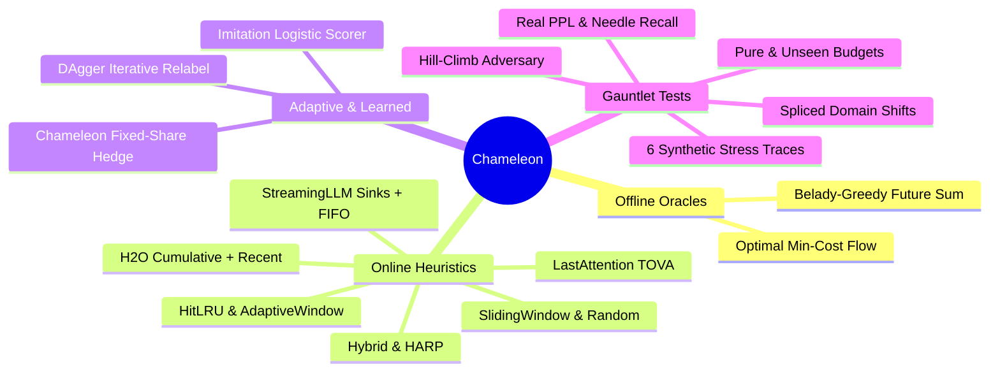
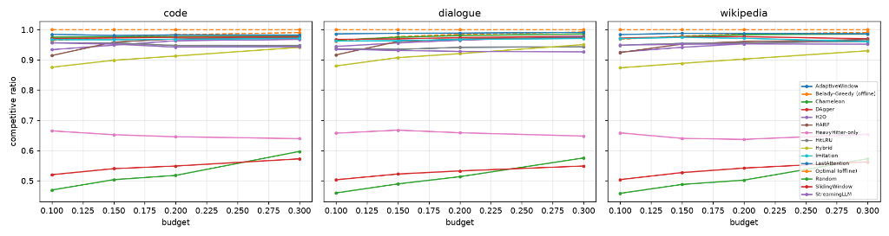
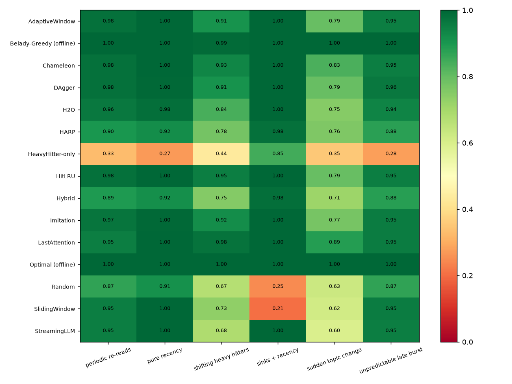
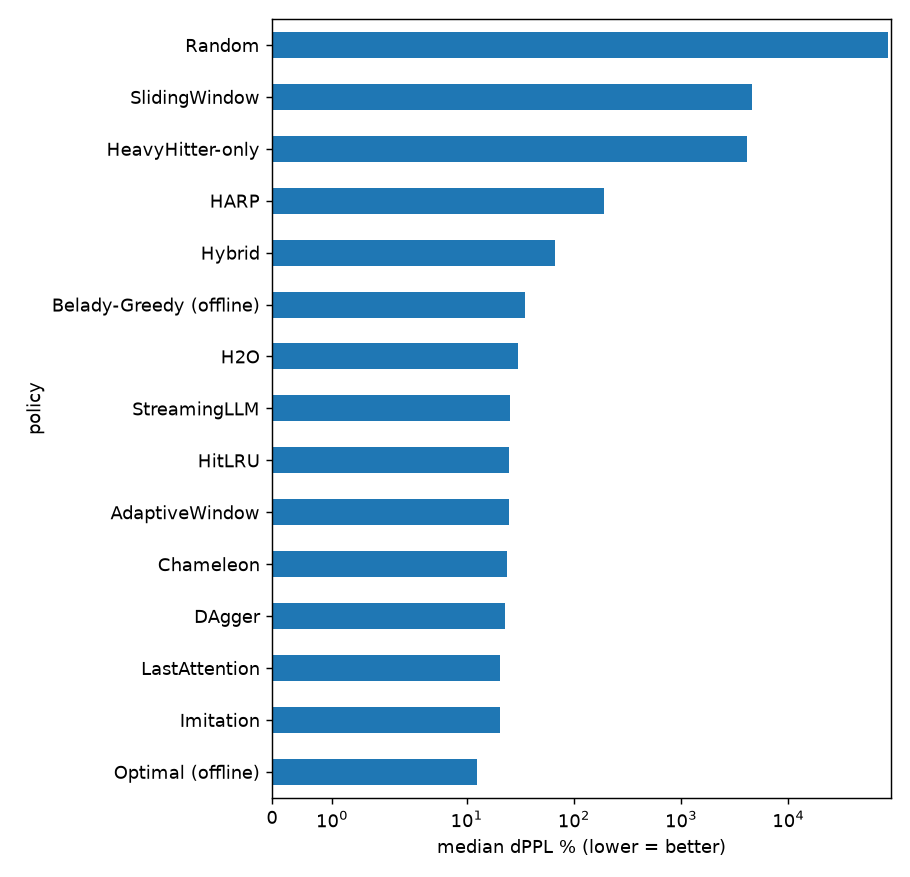
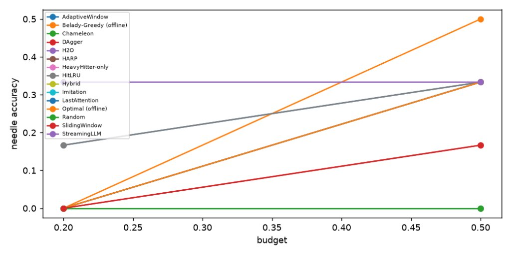

<div align="center">

# CHAMELEON

### Online KV-Cache Eviction, Exact Min-Cost Flow Optimum & The Gauntlet Evaluation Suite

[](https://www.python.org/)
[](https://pytorch.org/)
[](https://huggingface.co/docs/transformers/)
[](https://developers.google.com/optimization)
[](https://numpy.org/)
[](https://scikit-learn.org/)
[](https://huggingface.co/Qwen/Qwen2.5-0.5B)

[Experiment Notebook](notebooks/kv_bench.ipynb)   •   [Research Paper](docs/paper/kv_cache_eviction_paper.pdf)   •   [Study Guide](docs/paper/study_guide.pdf)   •   [Results](#6-empirical-results--the-gauntlet-scorecard)

</div>

---

## What is Chameleon?

During autoregressive generation, Large Language Models store the Keys and Values (**KV cache**) of all prior tokens to avoid recomputing self-attention. As contexts grow, KV-cache memory becomes the primary inference bottleneck. Under a strict cache budget $k < T$, an **eviction policy** must permanently discard past tokens at every step—unlike classical OS paging, evicted KV entries are **never re-fetched**.

Because decisions are irreversible and made without knowing future queries, KV-cache eviction is a classic **online optimization problem**. Yet evaluating eviction heuristics cleanly has remained difficult:
- **No exact benchmark ceiling**: Most studies compare heuristics only against each other or against greedy oracles, leaving the true competitive ratio vs. the offline optimum unknown.
- **Brittle, hand-tuned signal mixes**: Popular rules hard-code static trade-offs (e.g., H2O's 50/50 recency-attention split or StreamingLLM's fixed sink window) that break when text distributions shift mid-sequence (`wiki → code → dialogue`).
- **Proxy vs. real-quality mismatch**: Retaining aggregate attention mass does not automatically preserve next-token perplexity or rare-fact (*needle-in-a-haystack*) recall.
- **Data leakage in learned policies**: Learning-based evictors frequently overfit to seen domains, seen budgets, or teacher trajectories instead of their own rollout states.

This project answers one central question—**how far are practical online KV-cache eviction policies from the exact offline optimum?**—by combining an **exact Min-Cost Flow offline solver**, a training-free online-learning hybrid (**Chameleon**), leakage-free learned policies (**Imitation Learning & DAgger**), and a pre-registered 15-policy evaluation battery (**The Gauntlet**) on **Qwen2.5-0.5B**.

---

## 1. 4-Tier Algorithmic & Experimental Architecture

The codebase separates core online algorithms, learned teachers/students, physical LLM cache pruning, and statistical evaluation into four clean tiers:


### Module Breakdown

| Tier & Component | Core Files | Primary Capabilities |
| :--- | :--- | :--- |
| **Tier 1: Core & Exact Optimum** | [`src/core.py`](src/core.py) | **Online Policies, Simulator & Min-Cost Flow Solver.** Implements `Policy`, `Random`, `SlidingWindow`, `StreamingLLM`, `HeavyHitter` (H2O), `Hybrid`, `BeladyGreedy`, `ScheduledPolicy`, and the exact $O(T^2)$-arc `optimal_schedule` via Google OR-Tools. |
| **Tier 2: Adaptive & Learned** | [`src/chameleon.py`](src/chameleon.py)<br>[`src/hybrids.py`](src/hybrids.py)<br>[`src/imitation.py`](src/imitation.py) | **Online Learning, Team Hybrids & Imitation/DAgger.** `Chameleon` (Fixed-Share Hedge) & `LastAttention` (Aayush); `HitLRU` & `AdaptiveWindow` (Krishna); `HARP` (Kaushal); `Imitation` & `DAgger` past-only logistic scorers. |
| **Tier 3: Physical LLM Engine** | [`src/model.py`](src/model.py) | **True KV-Cache Deletion on Qwen2.5-0.5B.** Extracts layer/head-averaged attention matrices `A[t, j]` and runs token-by-token decoding while physically pruning `DynamicCache` tensors and keeping original RoPE `position_ids`. |
| **Tier 4: The Gauntlet Battery** | [`src/gauntlet.py`](src/gauntlet.py)<br>[`configs/default.yaml`](configs/default.yaml) | **Pre-Registered Unified Benchmark.** Wraps every policy in a `Spec`, enforces zero future leakage (`check_causal`) and dev/test splitting, runs spliced domain-shift tests, hill-climb adversary search, stress traces, ablations, and `verdict()`. |

---

## 2. Exact Offline Optimum & Online Learning Mechanics

Evaluating online heuristics rigorously requires both a provably exact offline ceiling and principled online adaptation mechanisms:



### 1. Exact Offline Optimum via Min-Cost Flow (`optimal_schedule`)
- **Graph Construction**: Time nodes $0, \dots, T$ (capacity-$k$ idle arcs $t \to t+1$ with cost $0$) plus one token node $\text{tok}_j$ per token $j$.
- **Retention Arcs**: For each eviction time $e \ge j$, arc $\text{tok}_j \to e+1$ has capacity $1$ and cost $C - V(j, e)$, where $V(j, e) = \sum_{s=j}^{e} A[s, j]$ is total attention retained while token $j$ stays cached.
- **Integrality Guarantee**: Because every network flow constraint matrix is **totally unimodular**, the LP/flow optimum is guaranteed integral—yielding an exact, valid eviction schedule `end[j]` in polynomial time (verified identical to brute-force search on small instances).

### 2. Chameleon: Training-Free Online Ensemble (`src/chameleon.py`)
Instead of hard-coding signal weights, **Chameleon** maintains $N = 5$ experts (`recency`, `cumulative`, `last-step`, `slow-EMA`, `hit-rate`) and updates weights $w_t$ after observing each step's attention using **Fixed-Share Hedge**:
$$v_{t,i} = \frac{w_{t,i} \exp(-\eta \ell_{t,i})}{\sum_j w_{t,j} \exp(-\eta \ell_{t,j})}, \qquad w_{t+1,i} = (1 - \alpha) v_{t,i} + \frac{\alpha}{N}$$
- **Provable Surrogate Regret Guarantee** (verified on every run by `regret_check`):
  $$\sum_{t=1}^{T} \langle w_t, \ell_t \rangle \le \min_{i \in \{1,\dots,N\}} \sum_{t=1}^{T} \ell_{t,i} + \frac{\ln N}{\eta} + \frac{\eta T}{8} + \frac{T}{\eta}\ln\!\left(\frac{1}{1-\alpha}\right)$$
- **Zero Leakage**: Requires no offline training, no teacher schedule, and no access to future rows; fixed-share mixing ($\alpha = 5/T$) enables rapid switching during mid-sequence domain shifts.
- *Honest Caveat*: The regret bound applies to the expert weights on the surrogate ranking loss $\ell_t \in [0, 1]$, not directly to the competitive ratio.

---

## 3. The Gauntlet Evaluation Protocol

Every policy—hand-designed, adaptive, learned, or offline—is wrapped in an identical `Spec` interface and tested under a pre-registered protocol (`verdict()`) with strict dev/test separation (even indices = dev, odd indices = test) and cross-domain training (test on domain $X \implies$ train only on domains $\neq X$):



| Test Stage | What It Measures | Leakage & Rigor Safeguard |
| :--- | :--- | :--- |
| **Test 0: Self-Tests** | Brute-force optimality, optimum dominance, capacity $\le k$, strict causality, regret bound | Future rows of $A$ are scrambled after step $t_0$; past decisions must remain bit-identical. |
| **Test 1: Scoreboard** | Competitive ratio across pure domains (`wikipedia`, `code`, `dialogue`) and unseen budgets | Evaluated strictly on held-out TEST sequences; paired bootstrap 95% CIs & Holm-Wilcoxon tests. |
| **Test 2: Domain Shift** | Real Qwen attention on spliced sequences (`wiki > code > dial`, etc.) | Built from disjoint text chunks never seen in training or pure test sets. |
| **Test 3: Adversary & Stress** | Hill-climb search for each policy's worst attention matrix + 6 synthetic stress patterns | Empirical upper bound on worst-case competitive ratio. |
| **Test 4: Physical Quality** | Real next-token perplexity ($\Delta\text{PPL}\%$) & Needle-in-a-Haystack retrieval | Physically deletes evicted KV tensors from `DynamicCache`; checks Kendall $\tau$ proxy validity. |
| **Test 5: Overhead & Regret** | Decision latency ($\mu\text{s/step}$), peak memory (KB), and realized vs. theoretical regret | `tracemalloc` profiling + 100% regret-bound verification across all budgets and domains. |

---

## 4. Key Scientific Findings & Edge-Case Insights

Running the full 15-policy Gauntlet on real **Qwen2.5-0.5B** attention and physically pruned caches revealed five sharp findings:



### 1. `LastAttention` (TOVA-Style) Wins Overall—and Beats Offline `Belady-Greedy`
- Evicting the token with the lowest *most-recent* attention achieves **0.986** pure competitive ratio, **0.992** under domain shift, the highest online adversarial worst case (**0.765**), **+20.6%** median $\Delta\text{PPL}$, and a **95.8%–100%** pairwise win-rate over every other online and learned policy—all in **$O(k)$ time (~44.9 µs/step)**.
- Remarkably, it outperforms offline **Belady-Greedy** on both pure attention ratio (**0.986 vs. 0.979**, 66.7% pairwise win-rate) and perplexity (**+20.6% vs. +34.9%**), because greedy future-sum hoarding sacrifices recently active tokens (`lost_recent` $\approx 1\text{--}3\%$).

### 2. `Chameleon` Ranks #2 Online, Beating All Learned & Classic Baselines
- Chameleon achieves **0.978** pure ratio and **0.984** shift ratio, beating `DAgger` (**79.2%** win-rate), `Imitation` (**95.8%**), `H2O` (**100%**), `StreamingLLM` (**100%**), `HitLRU`/`AdaptiveWindow` (**100%**), and `HARP` (**95.8%**).
- Its regret bound held in **100% of runs (27/27)** (`outputs/tables/chameleon_regret.csv`), and its online weights reliably converged toward `last-step` (climbing from `0.20` to `0.40–0.67` while suppressing `cumulative` to `~0.02–0.03`).
- Because `last-step` was the single best fixed expert in **27/27** runs, Chameleon naturally pays a small online exploration/mixing tax (~0.008 ratio, 538 µs/step) relative to oracle-selected `LastAttention`—yet **outperforms `LastAttention` on periodic re-reads** (`0.98` vs. `0.95`).

### 3. Pruning *Improves* Perplexity Under Mid-Sequence Domain Shift (Negative $\Delta\text{PPL}\%$)
- On `shift:wiki>code>dial` (full-cache PPL = `49.98`), pruning reduced perplexity across top policies: `Optimal` **-11.6%**, `Belady-Greedy` **-10.1%**, `LastAttention` **-8.2%**, `Chameleon` **-6.2%**, and `DAgger` **-2.5%**. Similar improvements appear on `shift:code>dial>wiki` (`Chameleon` **-5.3%**, `StreamingLLM` **-4.9%**).
- **Mechanism**: Evicting stale tokens from the *prior* domain eliminates out-of-distribution attention noise after a topic switch.

### 4. When the Attention Proxy Breaks Down (`HARP` & `Belady-Greedy`)
- `HARP` attains **0.953** attention ratio (matching `H2O`), yet suffers **+192.4% $\Delta\text{PPL}$** (6× worse than H2O). Similarly, `Belady-Greedy` hits **0.979** ratio yet **+34.9% $\Delta\text{PPL}$** (worse than `StreamingLLM`'s +25.6% at 0.943 ratio).
- **Root Cause**: Gap decomposition (`outputs/tables/scoreboard_detailed.csv`) shows both drop *recent* tokens (`lost_recent` = 1%–8%). For next-token prediction, losing even 1–2% of recent-token attention damages perplexity far more than losing long-range tokens.

### 5. Rare-Fact Recall Misalignment (Why Even `Optimal` Gets 16.7% on Needle)
- At needle depths `0.1` and `0.5`, nearly all policies fail—including `Optimal (offline)` (**16.7%** accuracy). `StreamingLLM` achieves the highest overall needle accuracy (**33.3%**).
- **Mechanism**: A hidden needle receives near-zero attention until the final question token arrives, so maximizing aggregate attention mass causes even the offline optimum to evict it early.

---

## 5. Complete Policy & Evaluation Catalog



---

## 6. Empirical Results & The Gauntlet Scorecard

All 11 structured result tables are stored in [`outputs/tables/`](outputs/tables/) and figures in [`outputs/figures/`](outputs/figures/).

### Master Leaderboard ([`summary_leaderboard.csv`](outputs/tables/summary_leaderboard.csv))

| Policy | Family | Pure Ratio | Unseen Budget | Shift Ratio | Agree w/ Opt | Stress Worst | Adversary Worst | Median ΔPPL % | Needle Acc | Cost (µs/step) |
| :--- | :---: | :---: | :---: | :---: | :---: | :---: | :---: | :---: | :---: | :---: |
| **Optimal (offline)** | offline | 1.000 | 1.000 | 1.000 | 1.000 | 1.000 | — | +12.6% | 16.7% | 43.7 |
| **LastAttention (TOVA)** | online | **0.986** | **0.986** | **0.992** | 0.038 | **0.885** | **0.765** | +20.6% | 16.7% | 44.9 |
| *Belady-Greedy (offline)* | offline | 0.979 | 0.977 | 0.990 | 0.289 | 0.991 | 0.962 | +34.9% | 25.0% | 51.9 |
| **Chameleon** | online | 0.978 | 0.976 | 0.984 | 0.037 | 0.834 | 0.475 | +23.8% | 16.7% | 538.2 |
| **DAgger** | learned | 0.973 | 0.973 | 0.981 | 0.033 | 0.794 | 0.499 | +23.0% | 8.3% | 162.1 |
| **Imitation** | learned | 0.968 | 0.968 | 0.975 | 0.029 | 0.772 | 0.556 | **+20.5%** | 0.0% | 158.7 |
| **H2O** | online | 0.954 | 0.949 | 0.946 | 0.083 | 0.749 | 0.531 | +30.1% | 16.7% | 35.9 |
| **HARP** | online | 0.953 | 0.957 | 0.941 | 0.082 | 0.759 | 0.429 | +192.4% | 0.0% | 1182.9 |
| **AdaptiveWindow** | online | 0.949 | 0.948 | 0.962 | 0.016 | 0.794 | 0.497 | +25.0% | 25.0% | 114.3 |
| **HitLRU** | online | 0.949 | 0.948 | 0.961 | 0.016 | 0.794 | 0.550 | +25.0% | 25.0% | 54.9 |
| **StreamingLLM** | online | 0.943 | 0.945 | 0.956 | 0.015 | 0.597 | 0.497 | +25.6% | **33.3%** | **13.8** |
| **Hybrid** | online | 0.907 | 0.898 | 0.886 | 0.079 | 0.714 | 0.410 | +67.0% | 0.0% | 44.8 |
| **HeavyHitter-only** | online | 0.652 | 0.653 | 0.604 | 0.000 | 0.271 | 0.306 | +4,133% | 0.0% | 53.6 |
| **SlidingWindow** | online | 0.535 | 0.530 | 0.545 | 0.000 | 0.206 | 0.703 | +4,620% | 8.3% | 13.0 |
| **Random** | online | 0.512 | 0.494 | 0.505 | 0.021 | 0.248 | 0.523 | +85,402% | 0.0% | 22.0 |

### Key Visualizations

<details open>
<summary><strong>1. Competitive Ratio Across Domains & Budgets</strong></summary>



</details>

<details open>
<summary><strong>2. Synthetic Stress-Trace Robustness Heatmap</strong></summary>



</details>

<details open>
<summary><strong>3. Real-Decoding Perplexity Degradation (Median ΔPPL %)</strong></summary>



</details>

<details open>
<summary><strong>4. Needle-in-a-Haystack Retrieval Accuracy</strong></summary>



</details>

---

## 7. Verification & Self-Test Scorecard

Before trusting any empirical table, `src.gauntlet.selftest()` and `regret_check()` validate mathematical optimality, zero future leakage, and regret guarantees:

```text
============================================================================
 Chameleon — Correctness & Theoretical Verification Scorecard
============================================================================
[1] Exact Min-Cost Flow == Brute Force == LP Fallback (6 instances) [PASSED]
[2] Learned Policies Train Leakage-Free on Synthetic Data           [PASSED]
[3] 28 Policies, 75 Tuning Grid Settings: Capacity & Causality      [PASSED]
[4] Chameleon Synthetic Self-Test Regret (8.51 <= 21.49 bound)      [PASSED]
[5] Chameleon Real-Qwen Regret Check (27/27 runs <= bound)          [PASSED]
----------------------------------------------------------------------------
Result Tables Exported : 11 validated CSVs in outputs/tables/
Figures Exported       : 4 publication plots in outputs/figures/
============================================================================
```

---

## 8. Getting Started & Reproducing Results

### Prerequisites
- Python 3.10+
- CUDA GPU recommended for Qwen2.5-0.5B attention extraction & pruned decoding (tested on T4 / server GPU; core algorithms & `selftest()` run on CPU in seconds)

### 1. Installation

```bash
pip install -r requirements.txt
```

### 2. Run Correctness Self-Tests (CPU, <5 seconds)

```bash
python -c "from src.gauntlet import selftest; selftest()"
```

### 3. Run Full Experiments

1. Open [`notebooks/kv_bench.ipynb`](notebooks/kv_bench.ipynb) in Jupyter or on a GPU server.
2. Choose a preset (`PRESET = "quick"` for smoke test, `"full"` for $T=512$ across 6 domains, or `"long"` for $T=2048$; see [`configs/default.yaml`](configs/default.yaml)).
3. Click **Run All** — stages are cached & crash-resumable under `runs/<PRESET>/`, with equal DEV-set tuning (`TUNE_BUDGET = 8`) per policy.

### Repository Layout

```text
kvcache/
├── README.md
├── requirements.txt
├── .gitignore
├── configs/
│   └── default.yaml                          # Quick / Full / Long presets & fairness rules
├── src/
│   ├── __init__.py                           # Package exports (all 15 policies + utilities)
│   ├── core.py                               # Base policies (with age-bias fix), simulator & min-cost flow
│   ├── chameleon.py                          # Chameleon Fixed-Share Hedge ensemble & LastAttention (Aayush)
│   ├── hybrids.py                            # HitLRU, AdaptiveWindow (Krishna) & HARP (Kaushal)
│   ├── imitation.py                          # Imitation learning & DAgger trainer (Aayush)
│   ├── model.py                              # 6-domain text loaders, O(T^2) attention hooks & DynamicCache pruning
│   └── gauntlet.py                           # Unified 15-policy registry, equal DEV tuning, adversary & self-tests
├── notebooks/
│   └── kv_bench.ipynb                        # Final self-contained multi-GPU server benchmark notebook
├── outputs/
│   ├── figures/                              # Publication plots (competitive ratio, stress, PPL, needle)
│   └── tables/                               # 11 CSV result tables (leaderboard, regret, win-rates, etc.)
└── docs/
    ├── paper/
    │   ├── kv_cache_eviction_paper.pdf       # Project report
    │   └── study_guide.pdf                   # Viva & concept study guide
    └── notes/
        └── build_log.txt                     # Engineering & experimental notes
```

---

## Limitations & Scope Notes

- **Layer/head-averaged eviction**: Decisions are shared across all 24 layers and 14 heads of Qwen2.5-0.5B to model a clean single online problem (production H2O/TOVA implementations operate per head).
- **Exact solver scaling**: The min-cost flow reduction uses $O(T^2)$ arcs, making exact offline optima tractable up to a few thousand tokens.
- **Surrogate vs. competitive-ratio guarantee**: Chameleon's provable regret bound applies to expert weights on the surrogate ranking loss $\ell_t$, while rank-averaging into an eviction decision is a heuristic.

---

<div align="center">

### CHAMELEON | AAYUSH RAHATE
*Design & Analysis of Algorithms — Online KV-Cache Eviction & Exact Offline Optima*

</div>
